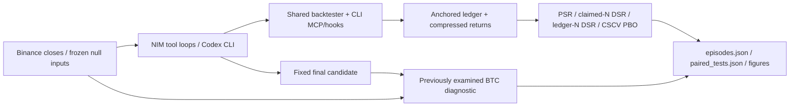
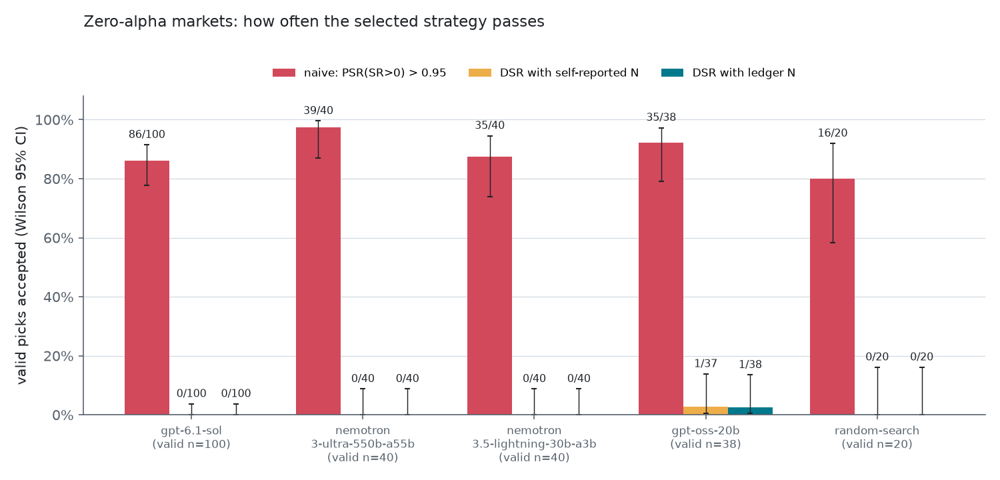

# trial-ledger

- **What:** Audit AI-agent backtests with a tamper-evident trial ledger.
- **Result:** Codex null picks: **86/100** pass naive PSR; **0/100** pass ledger-N DSR. [Results](experiments/results/causal-v2/paired_tests.json).
- **Run:** `uv sync --extra mcp --group experiments && uv run python -m experiments.run reproduce` ([setup](#reproduce)).

[Paper (PDF)](paper/main.pdf) · [LaTeX and generated inputs](paper/) · [Protocol](experiments/PROTOCOL.md)

**Count the backtests your AI agent actually ran.**

**105 real Codex CLI attempts** (`gpt-6.1-sol`, medium reasoning): on constructed
zero-conditional-mean markets, naive PSR accepts **86/100** valid completed
picks; ledger-N DSR accepts **0/100**. [Episode metrics](experiments/results/causal-v2/episodes.json); [paired results](experiments/results/causal-v2/paired_tests.json).

The NIM replication accepts **109/118 naive** versus
**1/118 ledger-N DSR** picks. NIM agents under-report distinct N in
**65/117 positive null-market claims**, with a maximum ledger/claim
ratio of **15.640×**. [paired results](experiments/results/causal-v2/paired_tests.json).

The Rust CSCV kernel is **182–1,136× faster than pypbo** on the memory-feasible
Linux cases, with checked outputs. [Benchmark and conditions](benchmarks/results/linux/pbo_benchmark.json).

`trial-ledger` captures backtests through MCP, shell hooks or an exec wrapper,
stores an externally anchored hash chain and compressed returns, and computes
Deflated Sharpe Ratio (DSR) and Probability of Backtest Overfitting (PBO).
A sweep records its configurations, rather than one tool invocation.

> **Correction history:** independent review found future-dependent volatility
> sizing in the first study. Its [225 receipts and old results](experiments/results/README.md)
> remain superseded evidence. These results use fresh searches with a fixed causal
> target under the [corrected protocol](experiments/PROTOCOL.md), not rescored old
> winners. Frozen null seeds are reused; the versions are not independent
> replications. The BTC period had already been examined and remains diagnostic.

**Code is MIT. Binance-derived data and research artifacts have non-commercial
restrictions (CC BY-NC-SA 4.0 plus Binance Vision terms).**
See [third-party notices](THIRD_PARTY_NOTICES.md).



## What the experiment establishes

The fixed search protocol asks agents to find an annualised Sharpe above the target
in [the recorded configuration](experiments/results/causal-v2/provenance.json). Null markets have zero
conditional mean before costs. NIM models run in our tool loop; Codex runs as a real
CLI process in a fresh temporary workspace with MCP and hooks configured. Scored
CLI evaluations use MCP; the shell hook is smoke-tested live. Both search predefined
rule families. [Protocol](experiments/PROTOCOL.md).

| Subject | Null attempts (valid picks) | Naive PSR [Wilson 95% CI] | Claimed-N DSR | Ledger-N DSR [Wilson 95% CI] | Under-reported N [Wilson 95% CI] | Source |
|---|---:|---|---:|---|---|---|
| Codex CLI | 100 (100) | 86/100 [77.86%, 91.47%] | 0/100 | 0/100 [0.00%, 3.70%] | 0/100 [0.00%, 3.70%] | [JSON](experiments/results/causal-v2/paired_tests.json) |
| NIM tool loops | 120 (118) | 109/118 [86.14%, 95.94%] | 1/117 | 1/118 [0.15%, 4.64%] | 65/117 [46.52%, 64.24%] | [JSON](experiments/results/causal-v2/paired_tests.json) |

Acceptance denominators use valid completed null picks; all failures remain in
attempt accounting and are never replaced by a best ledger trial. Count accounting
uses every positive claim, including invalid strategy answers. Missing or nonpositive
claims are reported separately and never classified as accurate. Wilson intervals
are nominal: models reuse market seeds, and pooled iid inference is not claimed.
Market/seed cluster-bootstrap intervals are also reported. With zero successes,
the percentile bootstrap collapses; retain the Wilson upper bound.

The four headline Wilson half-widths are 6.81, 1.85, 4.90, 2.25 percentage points (Codex naive/DSR, NIM naive/DSR), against the 10-point target. [paired results](experiments/results/causal-v2/paired_tests.json).



At the fixed primary threshold, claimed N and ledger N differ on **0/217 paired valid agent null picks**. Unadjusted model-specific McNemar tests and continuous-score Wilcoxon tests with Holm correction are in [paired results](experiments/results/causal-v2/paired_tests.json). The absence of observed decision discordance does not establish equivalence.

With observed claims, the six exploratory thresholds give claimed-only/ledger-only acceptances of 0.5: 15/1; 0.8: 1/0; 0.9: 0/0; 0.95: 0/0; 0.975: 0/0; 0.99: 0/0. These boundary checks keep the primary threshold fixed. [paired results](experiments/results/causal-v2/paired_tests.json).

**When can N change a decision?** The prespecified exploratory counterfactuals replace a claimed count with fractions of ledger N. At fractions 0.5: 1/218 crossings, 0.25: 9/218 crossings, 0.1: 28/218 crossings, 0.02: 130/218 crossings, a claimed-N acceptance becomes a ledger-N rejection. These are hypothetical counts, not observed claims. [paired results](experiments/results/causal-v2/paired_tests.json).

The first recorded counterfactual example (codex-cli/gpt-6.1-sol, signflip seed 49) changes N from ledger 7 to hypothetical 3, moving DSR from 0.7921 to 0.9542. Its actual claim was 7. [paired results](experiments/results/causal-v2/paired_tests.json); [boundary regression](tests/test_paired_tests.py).

The largest observed NIM under-report is 391/25 (nvidia/nemotron-3-ultra-550b-a55b, garch seed 12). Claimed-N DSR is 0.4160; ledger-N DSR is 0.0915. [episode metrics](experiments/results/causal-v2/episodes.json).

DSR uses estimated cross-sectional Sharpe dispersion and correlated counts;
a recorded N does not guarantee correct null rejection. No HAC correction is
implemented. Other thresholds and count scenarios remain exploratory and do not
replace the fixed primary rule.

On the **previously examined BTC diagnostic**, 5 Codex attempts yield 5 valid picks and 1 distinct rule. Their median annualised Sharpe is 1.167 in research and 0.552 in the later period; 5/5 decline. This is one exposed period with repeated rules, not independent evidence of alpha. [episode metrics](experiments/results/causal-v2/episodes.json).

Per-model outcomes, every failure status, DSR passes and BTC picks:
[RESULTS.md](experiments/results/causal-v2/RESULTS.md), [full precision](experiments/results/causal-v2/episodes.json),
[trial counts](experiments/results/causal-v2/figures/trial_count.png), [BTC figure](experiments/results/causal-v2/figures/btc_oos.png).

## Capture and audit

```bash
uv sync --extra mcp
# Optional Rust backend: uv sync --extra mcp --extra fast (requires cargo)

codex mcp add trial-ledger -- uv run --directory /path/to/trial-ledger \
  --extra mcp trial-ledger-mcp --data /path/to/prices.csv \
  --ledger /path/to/project/.trial-ledger --holdout-from 2024-01-01
```

The CSV needs `date` and either `close` or `return`. The server withholds rows from
`--holdout-from` onward. Claude Code examples:
[MCP configuration](examples/claude-code.mcp.json) and
[shell hook](examples/claude-code.settings.json). The experiment's isolated CLI
configuration, model arguments and capture adapter are in
[cli_agents.py](experiments/cli_agents.py).

For scripts, emit a scored record for every configuration. Otherwise a shell
backtest can only be counted as an unscored attempt:

```python
from trial_ledger import emit

emit(
    sharpe=per_period_sharpe,
    n_obs=len(returns),
    strategy={"lookback": lookback},
    dataset_hash=dataset_sha256,
    period={"time_axis_hash": scored_dates_sha256},
    periods_per_year=365,
)
```

Compute `dataset_sha256` from the evaluated input and `scored_dates_sha256` from
the ordered scored dates. Reports require one common dataset, time axis, length
and sampling frequency. Without return hashes, every scored emission counts as a
distinct evaluation, even if strategy metadata repeats. Legacy homogeneous ledgers
can use `report --assume-aligned`; that explicit assertion is labelled and cannot
override known mixed cohorts.

For PBO, use `record_trial(returns, strategy=..., dataset_hash=..., period=...,
periods_per_year=365)` from `trial_ledger`. It stores returns by default. Supply the
same identity metadata; equal series lengths alone do not establish alignment.
Run a `record_trial`-instrumented script directly with Python: it writes its ledger
records itself. The exec wrapper below is for the `emit` example.

```bash
trial-ledger exec -- python my_backtest.py
trial-ledger --dir experiments/results/causal-v2/runs/random-search/signflip-s0-r0/ledger verify --check-returns
trial-ledger --dir experiments/results/causal-v2/runs/random-search/signflip-s0-r0/ledger pbo
```

The corrected store verifies **265 ledgers** and **36,163 distinct per-ledger trial series**, backed by **29,609 shared objects**. [Integrity receipt and command](experiments/results/causal-v2/returns_integrity.json). The CLI reads them directly; [a recorded PBO result](experiments/results/causal-v2/pbo_cli_example.json) is committed alongside the ledgers. Superseded return objects remain separately preserved.

Return objects are compressed and addressed by the SHA-256 of canonical float64
content; loading verifies decompressed bytes. Old uncompressed objects remain
readable. PBO refuses a missing trial series rather than silently using a subset.
Hash-chain integrity requires a head anchored outside the subject's write access:
`trial-ledger head` and `verify --expect-head`. A writer able to replace both the
ledger and its only anchor can rebuild a consistent chain.

Shell capture records the command hash and executable/script by default.
Command previews are opt-in and redacted; malformed emitted trials remain visible
as unscored attempts. See [capture implementation](src/trial_ledger/hooks.py).

## Reproduce

Install the stable Rust toolchain (including Cargo) with
[rustup](https://rust-lang.org/tools/install/), then load its shell environment:

```bash
curl --proto '=https' --tlsv1.2 -sSf https://sh.rustup.rs | sh
. "$HOME/.cargo/env"
rustup default stable
```

Rust also needs a C linker: install the Command Line Tools with
`xcode-select --install` on macOS, or `sudo apt-get install build-essential` on
Debian/Ubuntu. Install [Tectonic](https://tectonic-typesetting.github.io/book/latest/installation/)
with `brew install tectonic` on macOS, or `conda install -c conda-forge tectonic`
on Linux/macOS.

For a fresh clone, **budget about 700 MB of downloads for committed results,
cached responses and frozen inputs** ([size audit](experiments/results/reproduction_size.json)).
Actual transfer depends on Git history and compression; toolchain and dependency
downloads are additional. The replay below uses those already cloned artifacts.

```bash
uv sync --all-extras --group dev --group experiments --group bench
uv run --no-sync python -m experiments.run reproduce
uv run --no-sync pytest
CARGO_BUILD_JOBS=2 cargo test --release --manifest-path rust/Cargo.toml
uv run --no-sync python paper/make_tables.py
tectonic -X compile paper/main.tex
```

Reproduction makes no inference calls: it replays committed NIM responses, audits
CLI ledgers, re-evaluates logged specs against return hashes, and rebuilds tables,
paired tests and figures. **Offline reproduction does not replay Codex inference.**
Failed API attempts receive exact cache-prefix and missing-response boundary
audits; provider outages themselves are not replayed.
Frozen GARCH inputs preserve exact bytes across architectures; fitting parameters
alone was insufficient because the Student-t sampler also differed across libm
implementations. Failed fixes and commands are retained in [ITERATIONS.md](ITERATIONS.md).

New inference runs are resumable; completed failures remain visible:

```bash
# NVIDIA_API_KEY is read from the environment, never passed on the command line.
uv run --no-sync python -m experiments.run agents --seeds 0-19 \
  --markets signflip garch btc --btc-reps 5 --workers 1 --resume
uv run --no-sync python -m experiments.cli_agents --agent codex \
  --seeds 0-49 --markets signflip garch --reps 1
uv run --no-sync python -m experiments.cli_agents --agent codex \
  --seeds 0-4 --markets btc --reps 1
```

The CLI runner invokes `codex exec -m gpt-6.1-sol -c model_reasoning_effort=medium`
with isolated configuration. Each NIM batch takes one of two shared atomic
`mkdir` slots (`nim-slot-1` or `nim-slot-2`) and makes serial requests,
retries transient failures with backoff, caches each response,
and releases the slot on exit or termination. Long-job diagnostics stay in ignored
root `runs/`; research receipts are committed under `experiments/results/causal-v2/runs/`.

## Provenance

| Evidence | Result and reproduction record |
|---|---|
| Acceptance, counts, submitted specs, moments and BTC diagnostic metrics | [episodes.json](experiments/results/causal-v2/episodes.json); [summary.json](experiments/results/causal-v2/summary.json) |
| Decisions, uncertainty, paired tests and exploratory conditions | [paired_tests.json](experiments/results/causal-v2/paired_tests.json), including analysis command, source hashes, seeds and configuration |
| Generation receipts and artifact checksums | [provenance.json](experiments/results/causal-v2/provenance.json); [episode receipts](experiments/results/causal-v2/runs/); [response caches](experiments/cache/) |
| Corrected NIM launch commands and loaded source snapshot | [nim_launches.json](experiments/results/causal-v2/nim_launches.json); exact seeds, model aliases and original batch commands |
| Stored returns and frozen inputs | [returns_integrity.json](experiments/results/causal-v2/returns_integrity.json); [GARCH archive manifest](experiments/data/garch_markets.json) |
| Native performance and output equality | [isolated Linux comparison](benchmarks/results/linux/kernel_interleaved.json); [full Linux benchmark](benchmarks/results/linux/pbo_benchmark.json); [runner receipt](benchmarks/results/linux/run.json) |
| Review regressions and complete-sample CI | [review_verification.json](experiments/results/causal-v2/review_verification.json); fixes and failed iterations in [ITERATIONS.md](ITERATIONS.md) |
| Paper tables, figure and PDF build | [committed input/output hashes](paper/generated/manifest.json); [build and page-review receipt](paper/build.json); [verified reference metadata](paper/reference_verification.json) |

Hosted weight revisions were not pinned or recorded. Model aliases, CLI
versions, settings and available source snapshots are recorded; Hugging Face
revisions in the licence audit identify the card checked, not the deployed model.
Superseded first-version NIM episodes did not record their exact launch command: the committed
cache and ledger establish replay, and the current regeneration command/source are
recorded without inventing historical metadata. Receipt corrections and interrupted
prefixes are explicit in [the iteration log](ITERATIONS.md).
Corrected batches retain their saved launch commands and source commit. Their
per-episode file hashes describe the workspace at receipt creation; the launch
record identifies the source snapshot loaded by a long-running process.

## Rust CSCV performance

An isolated Linux runner measured **182–1,136×** Rust/pypbo median speedups over the feasible cases. The largest pypbo matrix exceeds the prespecified memory cap and is skipped. This replaces the historical M1 best-run range with a different hardware/method baseline, not a claimed improvement over those old ratios. [Full benchmark](benchmarks/results/linux/pbo_benchmark.json).

The randomized interleaved comparison improves all fixed Rust cases by **1.09–1.17×** over the original kernel. The largest case goes from **219.863 to 189.664 ms**, with all output arrays byte-identical. Shared-M1 runs include regressions and unstable timings, which remain available. [Interleaved inputs, order and all samples](benchmarks/results/linux/kernel_interleaved.json); [successful runner receipt](benchmarks/results/linux/run.json).

The kernel uses block-major sufficient statistics, contiguous column updates,
rayon chunks and reusable scratch buffers. OOS scoring and rank reduction share
a pass. Most speedup over pypbo is algorithmic: the block-statistics NumPy reference
also avoids rebuilding train/test matrices for every split. No fast-math is used.
Rust variants and thread counts preserve byte-identical output arrays; comparisons
with NumPy/pypbo check exact PBO and explicitly bounded logit tolerances.

| Observations × trials; partitions | Rust median, ms | pypbo median, ms | Ratio |
|---|---:|---:|---:|
| 1,000 × 50; 8 | 0.119 | 44.149 | 371.0× |
| 1,000 × 10; 16 | 3.416 | 3878.965 | 1135.5× |
| 2,190 × 100; 10 | 0.588 | 238.172 | 405.2× |
| 2,190 × 500; 8 | 1.341 | 244.291 | 182.2× |
| 2,190 × 1,000; 16 | 189.389 | memory cap | n/a |

All timing samples, inputs, seeds, source/native checksums and equality checks are
in [the Linux benchmark result](benchmarks/results/linux/pbo_benchmark.json). Historical best-run,
fused-median and concurrent M1 measurements are [retained](benchmarks/results/). Shared-machine
measurements do not establish a universal latency guarantee or a uniformly faster
end-to-end implementation. Re-run with:

```bash
RAYON_NUM_THREADS=2 OPENBLAS_NUM_THREADS=1 VECLIB_MAXIMUM_THREADS=1 \
  uv run --no-sync python -m benchmarks.bench_pbo
```

[CI](.github/workflows/ci.yml) builds and tests maturin wheels for macOS arm64 and
Linux x86_64, uploads them as workflow artifacts, and checks committed-ledger PBO.
Nothing is published to PyPI.

## Limitations

- One prompt, constrained strategy families and visible sweep sizes. The findings
  do not estimate arbitrary coding-agent search behaviour or deliberate evasion.
- Model identities, interfaces and tool-use patterns differ across cohorts;
  their contrasts do not isolate an interface effect.
- Nominal episode intervals do not remove dependence from shared market inputs;
  the cluster bootstrap and model-specific paired tests expose that limitation.
- Ledger N deduplicates identical returns. Related trials remain correlated, and
  effective N is only a heuristic. The DSR's estimated Sharpe dispersion can be
  too small; count capture does not solve that statistical assumption.
- A valid final specification can lie outside the recorded search; this is flagged
  in [episode metrics](experiments/results/causal-v2/episodes.json). Analysis scores that
  submitted specification and never substitutes the best logged trial.
- CSCV conditions on the logged trial universe. The agent formed that universe
  using the whole research window; its search is not rerun within each fold,
  which limits claims about end-to-end generalisation.
- Live hook firing is verified, but scored shell backtests outside MCP were not
  subjects in this experiment. Hook payload parsing also has synthetic tests.
- BTC is one asset and one previously examined period, with drift and beta
  exposure. The corrected rerun uses that period and is a diagnostic, not an untouched test. No test-based tuning
  occurs. Withholding tools does not exclude pretrained
  knowledge of public BTC history.
- Claude Code Haiku was skipped after its recorded OAuth refresh failure.
  Provider revisions and original launch metadata have the limits stated above.
- Binance-derived artifacts are restricted to non-commercial reuse under the
  [dataset terms and attribution](THIRD_PARTY_NOTICES.md).

## Prior art

- Gençay (2026), [*What survives honest evaluation? Leakage-safe, search-aware
  assessment of LLM-driven trading strategy discovery*](https://arxiv.org/abs/2608.27734),
  is the closest evaluation work. This repository contributes an auditable capture
  layer and compares self-reported counts with logged counts on constructed nulls.
- Bailey & López de Prado, [*The Deflated Sharpe Ratio*](https://www.davidhbailey.com/dhbpapers/deflated-sharpe.pdf);
  Bailey, Borwein, López de Prado & Zhu,
  [*The Probability of Backtest Overfitting*](https://www.davidhbailey.com/dhbpapers/backtest-prob.pdf).
- [pypbo](https://github.com/esvhd/pypbo) provides the separately licensed benchmark
  reference. Its AGPL source is fetched at a pinned commit into an ignored directory
  and is not included in the MIT runtime or wheels.

## Licence and citation

[MIT code licence](LICENSE), copyright Nicolas Coquelet.
Model, dataset and reference-code terms: [THIRD_PARTY_NOTICES.md](THIRD_PARTY_NOTICES.md).
Software citation: [CITATION.cff](CITATION.cff).
