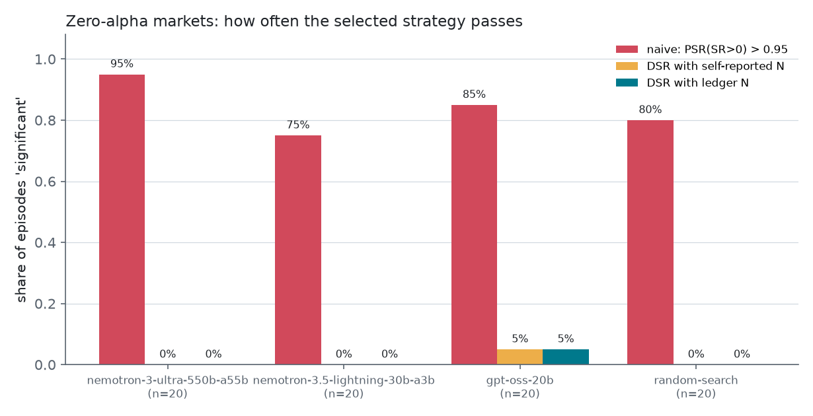
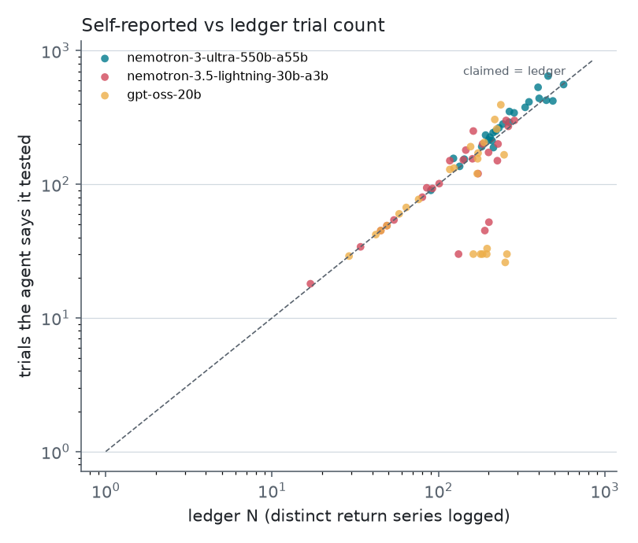
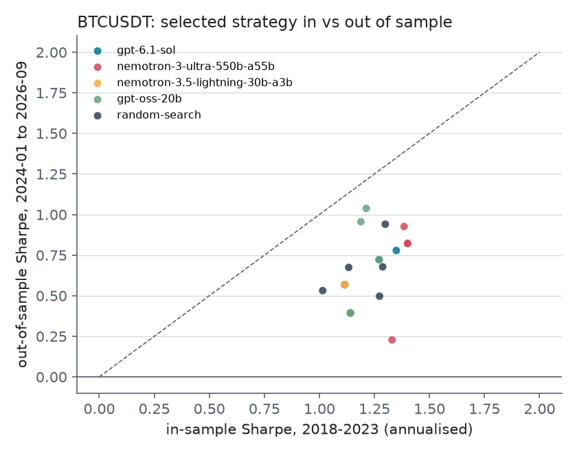

# trial-ledger

**Count the backtests your AI agent actually ran.**

`trial-ledger` sits between a coding agent and its backtester. Every backtest the agent runs,
through an MCP tool or a shell command, is appended to a hash-chained, tamper-evident ledger.
The Deflated Sharpe Ratio (DSR) and the Probability of Backtest Overfitting (PBO) are then
computed from that ledger's trial count, not from the number the agent reports.

**Result.** Three open-weight LLM agents were asked to find a strategy with annualised Sharpe
above 1 on markets that have zero alpha by construction (60 episodes). The strategy they
picked passed a naive significance test (PSR > 0.95) in **51 of 60 episodes (85%)**. With the
DSR at the ledger's trial count, **1 of 60 (2%)** passed. Agents claimed fewer strategies
than the ledger holds in 38% of episodes, by up to 9.7x. In 7 of the 10 worst cases they
reported their number of tool calls, not the configurations those calls evaluated. In this
experiment the claimed N was still large enough that the DSR rejected the same picks, so the
gain came from deflating at all; the ledger is what makes that N checkable. Details in
[Experiment](#experiment-agents-p-hack-null-markets) and
[`experiments/results/RESULTS.md`](experiments/results/RESULTS.md).

## The problem

A Sharpe ratio is only meaningful relative to how many strategies were tried before it was
found. With N independent trials and no skill, the expected best Sharpe ratio grows roughly
like `sqrt(2 log N)` standard errors. The DSR (Bailey & López de Prado, 2014) corrects for
this, but it needs N, and the variance of the trials' Sharpe ratios.

Coding agents make N large, cheap and invisible. One "let me try a few variants" turn can be
a 50-point grid search. The agent's summary says "I tested 12 strategies", and the human
reviewing it has no record of what ran. Existing PBO/DSR libraries
([pypbo](https://github.com/esvhd/pypbo),
[purged-cross-validation](https://github.com/eslazarev/purged-cross-validation),
[skill-backtest-overfit](https://github.com/quantskills/skill-backtest-overfit)) take N as an
input. `trial-ledger` measures it.

## What it does

| Layer | What |
|---|---|
| **Ledger** (`trial_ledger.ledger`) | Append-only JSONL. Each record holds the trial id, timestamp, agent and session, the strategy spec and its hash, code hash, dataset hash, period, `n_obs`, returns-series hash, Sharpe, skewness and kurtosis. It is chained as `hash = SHA-256(prev_hash ‖ canonical_json(record))`. A `HEAD` file anchors the tail. Writers are serialised with `flock`. Return series go to a content-addressed store so PBO can be recomputed and checked. |
| **Capture** | An MCP server (`trial-ledger-mcp`) exposes `run_backtest`, `run_sweep`, `list_trials`, `ledger_report` and `describe_dataset`, and logs each evaluation before returning it. A `PostToolUse` hook (`trial-ledger-hook`) logs backtests launched from the shell (Claude Code `Bash`, Codex-style `shell` events). `trial-ledger exec -- <cmd>` is a wrapper for any agent. `record_trial()` / `emit()` log from inside a script, one record per configuration. |
| **Statistics** (`trial_ledger.stats`) | PSR, and DSR with skewness and kurtosis and the expected maximum Sharpe under N trials (Bailey & López de Prado 2012, 2014). PBO via CSCV (Bailey, Borwein, López de Prado & Zhu 2017). Purged and embargoed K-fold. Effective number of trials. |
| **Rust core** (`rust/`) | PyO3 + rayon implementation of CSCV. It computes per-block sufficient statistics once, so each split costs O(S·N) instead of O(T·N). Its results match the NumPy reference exactly. |
| **CLI** | `trial-ledger verify` checks the chain and reports edits, deletions, reordering and truncation against the anchor. `trial-ledger report` gives N, best Sharpe, PSR, DSR with ledger N vs claimed N vs effective N, and PBO. |

## Quickstart

```bash
git clone https://github.com/ncoprod/trial-ledger && cd trial-ledger
uv sync --extra mcp            # add --extra fast to build the Rust core (needs cargo)
```

**Claude Code, MCP.** Add to your project's `.mcp.json` (see
[`examples/claude-code.mcp.json`](examples/claude-code.mcp.json)):

```json
{
  "mcpServers": {
    "trial-ledger": {
      "command": "uv",
      "args": ["run", "--directory", "/path/to/trial-ledger", "--extra", "mcp",
               "trial-ledger-mcp", "--data", "/path/to/prices.csv",
               "--ledger", "/path/to/project/.trial-ledger", "--holdout-from", "2024-01-01"]
    }
  }
}
```

The CSV needs a `date` column and either `close` or `return`. Rows from `--holdout-from` on
are never shown to the agent.

**Claude Code, shell hook.** This catches backtests run outside the MCP tool. Add it to
`.claude/settings.json` (see [`examples/claude-code.settings.json`](examples/claude-code.settings.json)):

```json
{
  "hooks": {
    "PostToolUse": [{
      "matcher": "Bash",
      "hooks": [{"type": "command",
                 "command": "uv run --directory /path/to/trial-ledger trial-ledger-hook --agent claude-code"}]
    }]
  }
}
```

**Codex.** Register the MCP server with
`codex mcp add trial-ledger -- uv run --directory /path/to/trial-ledger --extra mcp trial-ledger-mcp --data prices.csv`.
Codex CLI (0.155) has a stable `hooks` feature with `PostToolUse` events. Point a
`PostToolUse` command hook at `trial-ledger-hook --agent codex`. The hook accepts Codex-style
events (`shell`/`exec_command` tools, argv commands, `aggregated_output`). That parsing is
tested on synthetic events only; it has not been tested against a live Codex session. If your
agent has no hooks, wrap commands with `trial-ledger exec -- python my_backtest.py`.

**Inside your own backtest scripts.** Print one line per configuration so that a grid search
counts as N trials, not as one script run:

```python
from trial_ledger import emit

emit(sharpe=per_period_sharpe, n_obs=len(returns), strategy={"fast": 10, "slow": 50})
```

**Audit**

```console
$ trial-ledger --dir experiments/results/runs/openai__gpt-oss-20b/signflip-s0-r0/ledger verify
OK: 199 records, head fd8d5821eb83643c01cdbf29db50537f2de0c3048ac9d59853198caf82238f0c
$ trial-ledger --dir experiments/results/runs/openai__gpt-oss-20b/signflip-s0-r0/ledger report --claimed-n 155
records in ledger           199
distinct scored trials      172
unscored backtest runs      0
best trial                  #52 {'family': 'breakout', 'long_only': True, 'lookback': 10, 'vol_target': False}
best Sharpe (annualised)    0.99  (per period 0.0516, T=2190, skew=0.50, kurt=13.81)
PSR(SR>0), ignores N        0.993  [pass at 0.95]
E[max SR | N, null]         0.0649 per period
DSR with ledger N=172       0.265  [fail]
DSR with claimed N=155      0.278
PBO                         n/a (fewer than 2 trials with stored return series)
```

That ledger comes from the experiment below (gpt-oss-20b, sign-flip null market, seed 0; the
agent reported 155 strategies tested). The market has zero alpha by construction, the
naive test passes and the DSR with the logged N does not. (These committed experiment
ledgers do not store return series, so the CLI cannot compute PBO for them;
`experiments/analyze.py` recomputes it by re-running every logged spec.)

## Experiment: agents p-hack null markets

**Question.** Give an LLM agent a backtester and a target ("find annualised Sharpe > 1").
How often does its pick look significant when there is nothing to find, and does it report
how many strategies it tried?

**Setup** (code in [`experiments/`](experiments/)):

- **Markets.** Two zero-alpha markets of 2,190 daily returns, 10 seeds each.
  *signflip*: a stationary block bootstrap (mean block 20 days) of absolute BTCUSDT daily
  returns times i.i.d. random signs, so fat tails and volatility clustering are kept and the
  conditional mean is exactly zero. *garch*: a zero-mean GARCH(1,1) with Student-t shocks,
  fitted to the same BTC returns. One real market: BTCUSDT daily closes from
  [data.binance.vision](https://data.binance.vision) (checksums verified). The agent sees
  2018-01-01 to 2023-12-31; 2024-01-01 to 2026-09-30 is held out.
- **Agent.** A minimal OpenAI-compatible tool-calling loop
  ([`experiments/agent.py`](experiments/agent.py)) with the MCP server's tools:
  `run_backtest` (one strategy) and `run_sweep` (a grid of up to 50). Five rule families
  (momentum, MA crossover, mean reversion, breakout, RSI), with `long_only` and `vol_target`
  modifiers and 5 bps cost per unit of turnover. At most 30 backtest tool calls. It finishes
  with `submit_final_answer(strategy, annualized_sharpe, n_strategies_tested)`. The ledger's
  trial counter is hidden from the agent.
- **Models.** `nvidia/nemotron-3-ultra-550b-a55b`, `nvidia/nemotron-3.5-lightning-30b-a3b`
  and `openai/gpt-oss-20b`, served by the NVIDIA NIM API, at temperature 0.7. Per model: 10
  seeds x 2 null markets + 5 runs on BTC. **Baseline:** random search with the same 30-call
  budget, which reports its exact count.
- **Metrics.** The pick is re-run from its spec. Naive test: PSR(SR > 0) > 0.95. DSR with
  the agent's claimed N and with ledger N (distinct return series logged), using the
  skewness, kurtosis and Sharpe variance of the logged trials. PBO by CSCV (S = 16) on all
  logged trials. On BTC, the pick's out-of-sample Sharpe.

**Zero-alpha markets** (signflip and garch pooled, 20 episodes per agent; every pass is a
false positive; brackets are 95% Wilson intervals):

| agent | median ledger N | median claimed N | claimed < ledger N | ledger N / claimed, max | naive PSR pass | DSR pass, claimed N | DSR pass, ledger N | median PBO |
|---|---|---|---|---|---|---|---|---|
| nemotron-3-ultra-550b-a55b | 266 | 316 | 20% | 1.16 | 95% [76, 99] | 0% | 0% [0, 16] | 0.59 |
| nemotron-3.5-lightning-30b-a3b | 168 | 151 | 40% | 4.40 | 75% [53, 89] | 0% | 0% [0, 16] | 0.58 |
| gpt-oss-20b | 182 | 124 | 55% | 9.69 | 85% [64, 95] | 5% | 5% [1, 24] | 0.49 |
| random search | 133 | 174 | 0% | 0.94 | 80% [58, 92] | 0% | 0% [0, 16] | 0.52 |



What the numbers say:

1. **A naive test is useless after a search.** Across the 60 LLM episodes, 51 picks (85%,
   95% CI [74, 92]) pass PSR > 0.95. Random search does about as well (80%). The agents
   are not worse than chance at p-hacking; the search is what produces the false positive.
2. **Deflating fixes most of it.** DSR at the ledger's N passes 1 of 60 (2%, CI [0, 9]).
3. **Self-reported N is unreliable, but here it rarely changed the verdict.** Under-reporting
   is model-dependent. Nemotron Ultra's claims track the ledger (median ratio 0.90; it
   counts re-runs, so it often over-reports). gpt-oss-20b and Nemotron Lightning claimed
   fewer than a third of their distinct trials in 10 of 60 episodes (7 and 3). In 7 of those
   10, the claimed N equals the number of tool calls: a sweep of up to 50 configurations was
   counted as one strategy. Because even the claimed N is usually in the hundreds, the DSR with the
   claimed N rejects as often as with the ledger N here (median DSR 0.42 vs 0.27 for
   gpt-oss-20b). With fewer trials or a more confident agent that gap would decide the test.
4. **The DSR is not a guarantee.** The one null pick that passes (gpt-oss-20b, signflip seed
   5, N = 45, in-sample Sharpe 1.30) came from a search whose trial Sharpe ratios had an
   annualised SD of 0.29, below the 0.41 sampling error of a zero-Sharpe series over the
   same window. The DSR estimates the expected maximum from that dispersion, so it set the
   bar too low.



**BTCUSDT** (5 runs per agent; in-sample 2018-2023, out-of-sample 2024-01 to 2026-09):

| agent | mean in-sample Sharpe of pick | mean out-of-sample Sharpe | naive PSR pass | DSR pass, ledger N |
|---|---|---|---|---|
| nemotron-3-ultra-550b-a55b | 1.33 | 0.64 | 100% | 0% |
| nemotron-3.5-lightning-30b-a3b | 1.13 | 0.50 | 100% | 0% |
| gpt-oss-20b | 1.19 | 0.70 | 100% | 0% |
| random search | 1.20 | 0.66 | 100% | 0% |
| *buy and hold* | *0.63* | *0.76* | | |

Every pick beat buy-and-hold in sample (lowest pick 1.01, agent means 1.13 to 1.33, vs
0.63). Out of sample, every agent's mean pick did worse than buy-and-hold (0.50 to 0.70 vs
0.76). No pick passes the
DSR. That is consistent with the null-market result, but 20 runs on one asset prove little.



**Integrity.** All 100 ledgers (including the baseline) verify against their anchored heads.
Every logged trial re-runs from its spec to the same returns hash. All 100 episodes replay
identically from the committed response cache, with no API calls.

**Reproduce.** `make reproduce` (or `uv run python -m experiments.run reproduce`) replays
every episode from [`experiments/cache/`](experiments/cache/), re-runs every logged trial and
regenerates `episodes.csv`, `summary.json`, `RESULTS.md` and the figures. New API runs:
`NVIDIA_API_KEY=... uv run python -m experiments.run agents --seeds 0-9 --models <model>`.
Raw console logs are in `experiments/results/agents_batch*.log`.

## Rust core: CSCV benchmark

Same splits, same metric (per-column Sharpe, ddof=1). Before timing, the script checks that
pypbo, the NumPy reference and the Rust core return the same PBO and logits. Times are the
best wall-clock run, from [`benchmarks/results/pbo_benchmark.json`](benchmarks/results/pbo_benchmark.json):

Machine: macOS-27.0-arm64-arm-64bit-Mach-O, 8 logical CPUs, Python 3.13.17, NumPy 2.5.4; pypbo @ 4d723f0.

| T | N | S | splits | pypbo | NumPy generic | NumPy block-stats | Rust 1 thread | Rust parallel | Rust ∥ vs pypbo | Rust 1t vs NumPy block-stats |
|---|---|---|---|---|---|---|---|---|---|---|
| 1000 | 50 | 8 | 70 | 0.02 s | 0.01 s | 2.0 ms | 0.08 ms | 0.11 ms | 160x | 25.9x |
| 1000 | 10 | 16 | 12870 | 1.98 s | 0.86 s | 369.6 ms | 2.66 ms | 1.36 ms | 1,463x | 139.0x |
| 2190 | 100 | 10 | 252 | 0.13 s | 0.09 s | 7.6 ms | 0.44 ms | 0.48 ms | 272x | 17.4x |
| 2190 | 500 | 8 | 70 | 0.19 s | 0.11 s | 3.4 ms | 0.96 ms | 0.74 ms | 260x | 3.6x |
| 2190 | 1000 | 16 | 12870 | not run (~224 GB) | 50.87 s | 675.3 ms | 151.52 ms | 34.66 ms | n/a | 4.5x |

Read it honestly. The Rust core is **160x to 1,463x faster than pypbo** on the
cases pypbo can run. Most of that gain is algorithmic: per-block sufficient statistics make
each split O(S·N) instead of O(T·N), and the same algorithm in NumPy is already far ahead of
pypbo. Single-threaded Rust beats that NumPy version by 3.6x to 139x;
the larger gaps come from Python per-split overhead when there are many splits. pypbo also
keeps every split's matrices in memory, which rules it out for S = 16 at experiment scale
(~224 GB estimated for T = 2190, N = 1000).

## Limitations

- **Small, specific experiment.** Three open-weight models were served by NVIDIA's free NIM
  endpoint, with one prompt, one tool set (five rule families plus two modifiers), a 30-call
  budget and temperature 0.7. That is 10 seeds for each of the two null markets and 5 runs
  on BTC per model. The confidence intervals are wide. Agents that write arbitrary code
  search a far larger space than this. The experiment uses only the MCP capture path: the
  shell hook and `exec` wrapper are unit-tested but were not part of the agent runs. No
  headless Claude Code run was completed, because the local OAuth session had expired; the
  script is in `experiments/claude_code.py`.
- **Self-reported N depends on what the tools show.** `run_sweep` returns `n_evaluated`, so a
  careful agent can add those up exactly. The ledger's running trial id is hidden from the
  agent, because a pilot showed that models simply copy it. The undercount measured here is a
  lower bound on what free-form scripts would produce.
- **The DSR's expected maximum comes from the trials themselves.** It uses the cross-sectional
  variance of the logged Sharpe ratios. A search over near-identical variants has a small
  variance, which lowers the bar; one null pick in 60 passed that way (see the experiment).
  The ledger fixes N, not this.
- **What N means.** The ledger counts *distinct return series*: a re-run of an identical
  configuration counts once. Neighbouring grid points are strongly correlated, so the DSR
  with the raw count is conservative. The report also gives an effective N from the average
  pairwise correlation, a heuristic. The DSR relies on a Gaussian approximation for the
  maximum of the trials' Sharpe ratios, and on their cross-sectional variance.
- **"Zero alpha" means zero conditional mean.** In both null markets, E[r(t+1) | past] = 0
  exactly, so no rule has positive expected return before costs. Volatility is still
  predictable, so vol-targeting changes risk, and a strategy's realised Sharpe still has
  sampling noise around zero. That noise is exactly what a search over hundreds of trials
  harvests.
- **BTC out-of-sample is one asset and one 33-month window** (2024-01 to 2026-09). It has
  strong drift, so long-biased picks inherit beta. It is a sanity check, not evidence of
  skill.
- **Tamper evidence needs an external anchor** (see below). An agent with write access to the
  ledger directory could rewrite it consistently. In production, run the MCP server outside
  the agent's sandbox and anchor `trial-ledger head` somewhere the agent cannot write.

## Related work

- **Gençay (2026)**, [*What survives honest evaluation? Leakage-safe, search-aware assessment
  of LLM-driven trading strategy discovery*](https://arxiv.org/abs/2608.27734). This is the
  closest work. Its system records every strategy evaluation its own search performs and
  deflates by that count. On real equity and ETF universes it rejects every LLM-discovered
  strategy. `trial-ledger` differs in three ways. It is an agent-agnostic capture layer: MCP
  server, shell hooks, exec wrapper, and a hash chain you can audit after the fact. Its
  experiment uses markets with zero alpha by construction, so every "discovery" is known to
  be false. And it compares the agent's self-reported N with the logged N.
- **Kvasiuk, Li, Colegrove & Münchmeyer (2026)**, [*MadEvolve: Evolutionary Optimization of
  Trading Systems with Large Language Models*](https://arxiv.org/abs/2605.23007). LLM-driven
  evolutionary search and Claude Code agentic search on Bitcoin strategies, with an analysis
  of p-hacking probabilities on their simulation setup.
- Bailey & López de Prado (2012), *The Sharpe Ratio Efficient Frontier* (PSR). Bailey &
  López de Prado (2014), *The Deflated Sharpe Ratio*. Bailey, Borwein, López de Prado & Zhu
  (2017), *The Probability of Backtest Overfitting*. López de Prado (2018), *Advances in
  Financial Machine Learning*, ch. 7 (purged K-fold).
- Tools that take N as an input: [pypbo](https://github.com/esvhd/pypbo) (PBO, PSR, DSR),
  [purged-cross-validation](https://github.com/eslazarev/purged-cross-validation),
  [skill-backtest-overfit](https://github.com/quantskills/skill-backtest-overfit) (an agent
  skill that applies DSR/PBO given N).

## Security and privacy notes

- **No command text by default.** Shell hooks and `trial-ledger exec` record only
  `command_sha256` (hash of the exact command) and `program` (the executable, plus the
  script or module when it runs an interpreter such as `python`, `uv run` or `node`).
  `TRIAL_LEDGER_CAPTURE_COMMANDS=1` adds a token-level `command_preview`. In the preview, the
  values of flags whose names contain api, key, token, secret, pass, auth or credential are
  redacted, as are `VAR=value` assignments and any token of 20 or more characters that mixes
  letters and digits. The preview is truncated after redaction, at a token boundary. Raw
  commands are never stored.
- **Logging fails closed.** Every `TRIAL_LEDGER` line counts as one attempt. A line that
  cannot be parsed or validated is still recorded, as an unscored record with
  `extra.malformed = true` and the error type. A bad line never hides the trials around it,
  and N is never undercounted.
- **Tamper-evident, not tamper-proof.** Anyone with write access can rebuild a consistent
  chain. They cannot make it match a head hash anchored elsewhere earlier (`trial-ledger head`;
  commit it, or paste it in the report). `verify --expect-head` checks against that anchor.

## Development

```bash
make install    # uv sync with the Rust core, dev and experiment groups
make test       # pytest + cargo test
make lint       # ruff
make bench      # pypbo vs NumPy vs Rust (fetches pypbo at a pinned commit; AGPL, not vendored)
make reproduce  # replay every agent episode from the response cache, rebuild tables/figures
```

## Citation

```bibtex
@software{coquelet2026trialledger,
  author  = {Coquelet, Nico},
  title   = {trial-ledger: counting the backtests an AI agent actually ran},
  year    = {2026},
  version = {0.1.0},
  url     = {https://github.com/ncoprod/trial-ledger}
}
```

License: MIT.
