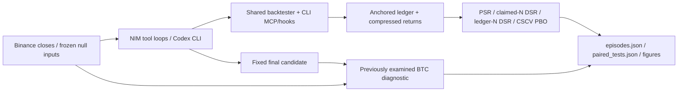

# trial-ledger

**Count the backtests your AI agent actually ran.**

> **Superseded study:** independent review found future-dependent volatility sizing.
> All empirical agent and BTC numbers below describe the old implementation and
> are withdrawn as evidence of causal strategies or a clean holdout. A fixed-target
> correction and fresh adaptive searches are underway under
> [causal-v2](experiments/PROTOCOL.md). The original artifacts remain preserved;
> rescoring them is not a replacement for fresh searches.

**65 real Codex CLI episodes** (`gpt-6.1-sol`, medium reasoning): on zero-alpha markets, naive PSR accepts **49/58** valid picks, while ledger-N DSR accepts **0/58**. Both rates meet the Wilson precision target. [2 invalid null submissions are retained](experiments/results/episodes.json); [paired results](experiments/results/paired_tests.json).

The NIM replication has **107/118 naive passes** versus **1/118 DSR passes**; **51/120 claims under-report N** (maximum **17.125×**). Claimed-N and ledger-N DSR make the same primary decisions. [paired results](experiments/results/paired_tests.json).

The Rust CSCV kernel is **182–1,135× faster than pypbo** on the memory-feasible isolated Linux cases, with checked outputs. [Benchmark and conditions](benchmarks/results/linux/pbo_benchmark.json).

`trial-ledger` captures backtests through MCP, shell hooks or an exec wrapper, stores
an externally anchored hash chain and compressed return series, and computes the
Deflated Sharpe Ratio (DSR) and Probability of Backtest Overfitting (PBO). A sweep
counts its configurations, rather than one tool invocation.

**Code is MIT. Binance-derived data and research artifacts have non-commercial
restrictions (CC BY-NC-SA 4.0 plus Binance Vision terms).**
See [third-party notices](THIRD_PARTY_NOTICES.md).



## What the experiment establishes

The same fixed search protocol asks agents to find a strategy with annualised
Sharpe above the target in [the evaluation configuration](experiments/results/provenance.json).
Null markets have zero conditional mean before costs. NIM models run in our tool
loop; Codex runs as a real CLI process in a fresh temporary workspace with MCP and
hooks configured. Its scored evaluations use MCP; its shell hook is smoke-tested
live. Both search predefined rule families, rather than arbitrary strategy code.
[Protocol](experiments/PROTOCOL.md).

| Subject | Null attempts (valid picks) | Naive PSR passes [Wilson 95% CI] | Claimed-N DSR passes | Ledger-N DSR passes [Wilson 95% CI] | Under-reported N [Wilson 95% CI] | Source |
|---|---:|---|---:|---|---:|---|
| Codex CLI | 60 (58) | 49/58 [73.07%, 91.62%] | 0/58 | 0/58 [0.00%, 6.21%] | 0/60 [0.00%, 6.02%] | [JSON](experiments/results/paired_tests.json) |
| NIM tool loops | 120 (118) | 107/118 [84.08%, 94.71%] | 1/118 | 1/118 [0.15%, 4.64%] | 51/120 [34.02%, 51.44%] | [JSON](experiments/results/paired_tests.json) |

Acceptance rates describe valid completed null-market picks; failures remain in
the attempt accounting and are never replaced with a best ledger trial. Trial-count
accounting uses all positive claims, including invalid final strategy answers.
Intervals are nominal Wilson intervals. Models reuse market seeds, so pooled iid
inference is not claimed; market/seed cluster-bootstrap intervals are also in
[the paired results](experiments/results/paired_tests.json). When no picks pass, the
percentile bootstrap collapses to zero; retain the Wilson upper bound.


At the fixed acceptance threshold, **claimed N and ledger N change no decisions** in either cohort; every model-specific exact McNemar p-value is 1.0. This does not establish equivalence. Codex has no observed under-reporting of distinct trials; the NIM counts and continuous-score Wilcoxon tests with Holm correction are in [paired results](experiments/results/paired_tests.json).

**When can N change a decision?** In the retained Codex GARCH seed 10 pick, ledger N = 30 gives DSR = 0.7341. Replacing it with a **hypothetical** claim of N = 7 gives DSR = 0.9613, crossing the primary threshold. The agent actually claimed N = 30. Observed score-boundary intervals and a controlled regression test are also provided: [sensitivity results](experiments/results/paired_tests.json), [test](tests/test_paired_tests.py). These are conditions for a possible effect, not additional observed false acceptances.

In the largest observed under-report (Nemotron Ultra, GARCH seed 17), the claim of
16 against ledger N = 274 gives DSR 0.7645 with claimed N versus 0.3332 with ledger N:
both reject. [Episode metrics](experiments/results/episodes.json).

The count is auditable even when it does not change a verdict. The DSR still uses
an estimated cross-sectional Sharpe variance and correlated trial counts; it does
not guarantee that a null pick will be rejected. Boundary thresholds and hypothetical
undercounts are exploratory, separately labelled, and never replace the primary
threshold in [the protocol](experiments/PROTOCOL.md).

On BTC, the 5 fixed Codex final picks (3 distinct specs) have median in-sample Sharpe 1.115 and held-out Sharpe 0.568. Every pick declines out of sample. This is one asset and one held-out period, with repeated specs, not independent evidence of alpha. [Full-precision BTC results](experiments/results/episodes.json).

Full per-model results, failures, individual DSR passes and BTC picks:
[RESULTS.md](experiments/results/RESULTS.md),
[full-precision episode metrics](experiments/results/episodes.json),
[trial-count figure](experiments/results/figures/trial_count.png),
[BTC figure](experiments/results/figures/btc_oos.png).

## Capture and audit

```bash
uv sync --extra mcp
# Optional Rust backend: uv sync --extra mcp --extra fast (requires cargo)

codex mcp add trial-ledger -- uv run --directory /path/to/trial-ledger \
  --extra mcp trial-ledger-mcp --data /path/to/prices.csv \
  --ledger /path/to/project/.trial-ledger --holdout-from 2024-01-01
```

The CSV needs `date` and either `close` or `return`. The server withholds rows from
`--holdout-from` onward. Claude Code examples:
[MCP configuration](examples/claude-code.mcp.json) and
[shell hook](examples/claude-code.settings.json). The experiment's isolated CLI
configuration, model arguments and capture adapter are in
[cli_agents.py](experiments/cli_agents.py).

For scripts, emit a scored record for every configuration. Otherwise a shell
backtest can only be counted as an unscored attempt:

```python
from trial_ledger import emit

emit(
    sharpe=per_period_sharpe,
    n_obs=len(returns),
    strategy={"lookback": lookback},
    dataset_hash=dataset_sha256,
    period={"time_axis_hash": scored_dates_sha256},
    periods_per_year=365,
)
```

Compute `dataset_sha256` from the evaluated input and `scored_dates_sha256` from
the ordered scored dates. Reports require one common dataset, time axis, length
and sampling frequency. Without return hashes, every scored emission counts as a
distinct evaluation, even if strategy metadata repeats. Legacy homogeneous ledgers
can use `report --assume-aligned`; that explicit assertion is labelled and cannot
override known mixed cohorts.

For PBO, use `record_trial(returns, strategy=..., dataset_hash=..., period=...,
periods_per_year=365)` from `trial_ledger`. It stores returns by default. Supply the
same identity metadata; equal series lengths alone do not establish alignment.
Run a `record_trial`-instrumented script directly with Python: it writes its ledger
records itself. The exec wrapper below is for the `emit` example.

```bash
trial-ledger exec -- python my_backtest.py
trial-ledger --dir experiments/results/causal-v2/runs/random-search/signflip-s0-r0/ledger verify --check-returns
trial-ledger --dir experiments/results/causal-v2/runs/random-search/signflip-s0-r0/ledger pbo
```

The latest restoration snapshot verifies **225 ledgers** and **35,108 distinct per-ledger trial series**, with **28,613 shared compressed objects**. [Integrity receipt and command](experiments/results/returns_integrity.json). The CLI reads these objects directly; [a recorded PBO result](experiments/results/pbo_cli_example.json) is committed alongside the ledgers.

Return objects are compressed and addressed by the SHA-256 of canonical float64
content; loading verifies decompressed bytes. Old uncompressed objects remain
readable. PBO refuses a missing trial series rather than silently using a subset.
Hash-chain integrity requires a head anchored outside the subject's write access:
`trial-ledger head` and `verify --expect-head`. A writer able to replace both the
ledger and its only anchor can rebuild a consistent chain.

Shell capture records the command hash and executable/script by default.
Command previews are opt-in and redacted; malformed emitted trials remain visible
as unscored attempts. See [capture implementation](src/trial_ledger/hooks.py).

## Reproduce

```bash
uv sync --all-extras --group dev --group experiments --group bench
uv run --no-sync python -m experiments.run reproduce
uv run --no-sync pytest
CARGO_BUILD_JOBS=2 cargo test --release --manifest-path rust/Cargo.toml
```

Reproduction makes no inference calls: it replays committed NIM responses, audits
CLI ledgers, re-evaluates logged specs against return hashes, and rebuilds tables,
paired tests and figures. **Offline reproduction does not replay Codex inference.**
Failed API attempts receive exact cache-prefix and missing-response boundary
audits; provider outages themselves are not replayed.
Frozen GARCH inputs preserve exact bytes across architectures; fitting parameters
alone was insufficient because the Student-t sampler also differed across libm
implementations. Failed fixes and commands are retained in [ITERATIONS.md](ITERATIONS.md).

New inference runs are resumable; completed failures remain visible:

```bash
# NVIDIA_API_KEY is read from the environment, never passed on the command line.
uv run --no-sync python -m experiments.run agents --seeds 0-19 \
  --markets signflip garch btc --btc-reps 5 --workers 1 --resume
uv run --no-sync python -m experiments.cli_agents --agent codex \
  --seeds 0-49 --markets signflip garch --reps 1
uv run --no-sync python -m experiments.cli_agents --agent codex \
  --seeds 0-4 --markets btc --reps 1
```

The CLI runner invokes `codex exec -m gpt-6.1-sol -c model_reasoning_effort=medium`
with isolated configuration. NIM batches take one shared atomic mkdir slot and
make serial requests, retry transient failures with backoff, cache each response,
and release the slot on exit or termination. Long-job diagnostics stay in ignored
root `runs/`; research receipts are committed under `experiments/results/runs/`.

## Provenance

| Evidence | Result and reproduction record |
|---|---|
| Acceptance, counts, submitted specs, moments and held-out metrics | [episodes.json](experiments/results/episodes.json); [summary.json](experiments/results/summary.json) |
| Decisions, uncertainty, paired tests and exploratory conditions | [paired_tests.json](experiments/results/paired_tests.json), including analysis command, source hashes, seeds and configuration |
| Generation receipts and artifact checksums | [provenance.json](experiments/results/provenance.json); [episode receipts](experiments/results/runs/); [response caches](experiments/cache/) |
| Corrected NIM launch commands and loaded source snapshot | [nim_launches.json](experiments/results/causal-v2/nim_launches.json); exact seeds, model aliases and original batch commands |
| Stored returns and frozen inputs | [returns_integrity.json](experiments/results/returns_integrity.json); [GARCH archive manifest](experiments/data/garch_markets.json) |
| Native performance and output equality | [isolated Linux comparison](benchmarks/results/linux/kernel_interleaved.json); [full Linux benchmark](benchmarks/results/linux/pbo_benchmark.json); [runner receipt](benchmarks/results/linux/run.json) |

Hosted weight revisions were not pinned or recorded. Model aliases, CLI
versions, settings and available source snapshots are recorded; Hugging Face
revisions in the licence audit identify the card checked, not the deployed model.
Superseded first-version NIM episodes did not record their exact launch command: the committed
cache and ledger establish replay, and the current regeneration command/source are
recorded without inventing historical metadata. Receipt corrections and interrupted
prefixes are explicit in [the iteration log](ITERATIONS.md).
Corrected batches retain their saved launch commands and source commit. Their
per-episode file hashes describe the workspace at receipt creation; the launch
record identifies the source snapshot loaded by a long-running process.

## Rust CSCV performance

An isolated Linux runner measured **182–1,135×** Rust/pypbo median speedups over the feasible cases. The largest pypbo matrix exceeds the prespecified memory cap and is skipped. This replaces the historical M1 best-run range with a different hardware/method baseline, not a claimed improvement over those old ratios. [Full benchmark](benchmarks/results/linux/pbo_benchmark.json).

The randomized interleaved comparison improves all fixed Rust cases by **1.09–1.17×** over the original kernel. The largest case goes from **219.863 to 189.664 ms**, with all output arrays byte-identical. Shared-M1 runs include regressions and unstable timings, which remain available. [Interleaved inputs, order and all samples](benchmarks/results/linux/kernel_interleaved.json); [successful runner receipt](benchmarks/results/linux/run.json).

The kernel uses block-major sufficient statistics, contiguous column updates,
rayon chunks and reusable scratch buffers. OOS scoring and rank reduction share
a pass. Most speedup over pypbo is algorithmic: the block-statistics NumPy reference
also avoids rebuilding train/test matrices for every split. No fast-math is used.
Rust variants and thread counts preserve byte-identical output arrays; comparisons
with NumPy/pypbo check exact PBO and explicitly bounded logit tolerances.

| Observations × trials; partitions | Rust median, ms | pypbo median, ms | Ratio |
|---|---:|---:|---:|
| 1,000 × 50; 8 | 0.119 | 44.149 | 371.0× |
| 1,000 × 10; 16 | 3.416 | 3878.965 | 1135.5× |
| 2,190 × 100; 10 | 0.588 | 238.172 | 405.2× |
| 2,190 × 500; 8 | 1.341 | 244.291 | 182.2× |
| 2,190 × 1,000; 16 | 189.389 | memory cap | n/a |

All timing samples, inputs, seeds, source/native checksums and equality checks are
in [the Linux benchmark result](benchmarks/results/linux/pbo_benchmark.json). Historical best-run,
fused-median and concurrent M1 measurements are [retained](benchmarks/results/). Shared-machine
measurements do not establish a universal latency guarantee or a uniformly faster
end-to-end implementation. Re-run with:

```bash
RAYON_NUM_THREADS=2 OPENBLAS_NUM_THREADS=1 VECLIB_MAXIMUM_THREADS=1 \
  uv run --no-sync python -m benchmarks.bench_pbo
```

[CI](.github/workflows/ci.yml) builds and tests maturin wheels for macOS arm64 and
Linux x86_64, uploads them as workflow artifacts, and checks committed-ledger PBO.
Nothing is published to PyPI.

## Limitations

- One prompt, constrained strategy families and visible sweep sizes. The findings
  do not estimate arbitrary coding-agent search behaviour or deliberate evasion.
- Nominal episode intervals do not remove dependence from shared market inputs;
  the cluster bootstrap and model-specific paired tests expose that limitation.
- Ledger N deduplicates identical returns. Related trials remain correlated, and
  effective N is only a heuristic. The DSR's estimated Sharpe dispersion can be
  too small; count capture does not solve that statistical assumption.
- A valid final specification can lie outside the recorded search; this is flagged
  in [episode metrics](experiments/results/episodes.json). Analysis scores that
  submitted specification and never substitutes the best logged trial.
- CSCV conditions on the logged trial universe. The agent formed that universe
  using the whole research window; its search is not rerun within each fold,
  which limits claims about end-to-end generalisation.
- Live hook firing is verified, but scored shell backtests outside MCP were not
  subjects in this experiment. Hook payload parsing also has synthetic tests.
- BTC is one asset and one previously examined period, with drift and beta
  exposure. The corrected rerun uses that period and is a diagnostic, not an untouched test. No test-based tuning
  occurs. Withholding tools does not exclude pretrained
  knowledge of public BTC history.
- Claude Code Haiku was skipped after its recorded OAuth refresh failure.
  Provider revisions and original launch metadata have the limits stated above.
- Binance-derived artifacts are restricted to non-commercial reuse under the
  [dataset terms and attribution](THIRD_PARTY_NOTICES.md).

## Prior art

- Gençay (2026), [*What survives honest evaluation? Leakage-safe, search-aware
  assessment of LLM-driven trading strategy discovery*](https://arxiv.org/abs/2608.27734),
  is the closest evaluation work. This repository contributes an auditable capture
  layer and compares self-reported counts with logged counts on constructed nulls.
- Bailey & López de Prado, [*The Deflated Sharpe Ratio*](https://www.davidhbailey.com/dhbpapers/deflated-sharpe.pdf);
  Bailey, Borwein, López de Prado & Zhu,
  [*The Probability of Backtest Overfitting*](https://www.davidhbailey.com/dhbpapers/backtest-prob.pdf).
- [pypbo](https://github.com/esvhd/pypbo) provides the separately licensed benchmark
  reference. Its AGPL source is fetched at a pinned commit into an ignored directory
  and is not included in the MIT runtime or wheels.

## Licence and citation

[MIT code licence](LICENSE), copyright Nicolas Coquelet.
Model, dataset and reference-code terms: [THIRD_PARTY_NOTICES.md](THIRD_PARTY_NOTICES.md).
Software citation: [CITATION.cff](CITATION.cff).
